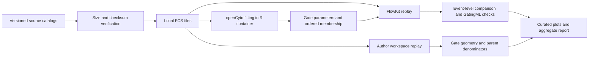

# Engineering and reproducibility

This repository connects public-data provenance, R gate fitting, Python gate replay, and a reviewable report. Its current results demonstrate engineering consistency on development data. They do not establish biological accuracy or product-release suitability.



## Boundaries and decisions

| Boundary | Implementation | Why it matters |
|---|---|---|
| Download to local evidence | `scripts/fetch_public_data.py` | Verify size and publisher checksum before accepting a file; reject traversal and corrupt existing files. |
| Fitted gate to Python replay | `scripts/opencyto_smoke.R`, `scripts/verify_gate_transfer.py` | Bind the source file and compare ordered event membership, not just matching counts. |
| Strategy to exported artifact | `scripts/gatingml_export.py` | Validate schema and supported membership roundtrip before publishing; reject unsupported transforms without overwriting valid output. |
| Workspace to displayed gate | `scripts/validate_existing_data.py`, `scripts/build_scatter_report.py` | Keep compensation, transformations, parent membership and plotted coordinates consistent. |
| Manual review to revised result | `scripts/apply_review_guidance.py` | Retain original gates, bind digitized guidance, recalculate descendants and denominators, and preserve downstream geometry. |
| Dataset to scientific claim | `data/manifests/`, `docs/DATASETS.md` | Separate files, derivatives, donors, fluorescence and mass cytometry. |

## Automated checks

The GitHub Actions workflow builds `docker/Dockerfile.python` and runs the regression suite without raw data or network access at runtime. Its image binds the Python base by digest, installs dependencies with required hashes, and runs as UID/GID 65532. Source is read-only; temporary files use a bounded tmpfs. Checkout uses a pinned action revision and read-only repository permissions.

The regression cases exercise corrupt downloads, path traversal, malformed HTTP ranges, bounded reads, event identity, parent containment, filename ambiguity, supported/unsupported exports, and reviewed gate geometry. These are tests of engineering behavior, not expert labels.

CI also checks that the 159 file-level figures exist, their source catalog hash matches the plot manifest, and the reviewed figures/configuration match recorded hashes. Those checks establish artifact consistency; they do not independently regenerate the scientific results.

Run the same isolated suite locally:

```sh
docker build -f docker/Dockerfile.python -t cytometry-tests:local .
docker run --rm --network none --read-only \
  --cap-drop ALL --security-opt no-new-privileges \
  --tmpfs /tmp:rw,nosuid,nodev,size=256m cytometry-tests:local
python3 scripts/check_report_assets.py
```

`docker/python-requirements.txt` is exported from `uv.lock`, including the development group and hashes. When changing dependencies, refresh both together:

```sh
uv lock
uv export --locked --no-emit-project --format requirements-txt \
  --output-file docker/python-requirements.txt
```

## Real-data checks

Real-FCS and R checks are separate local executions. CI does not download the cohort, rebuild the R environment, or claim to repeat the 71-file fitting run. Existing aggregate receipts and the full report describe those executed checks and their limitations.

For a bounded fresh check after fetching the documented starter data and building the R image:

```sh
mkdir -p reports/local/recheck
docker run --rm --network none --read-only \
  --cap-drop ALL --security-opt no-new-privileges \
  --tmpfs /tmp:rw,nosuid,nodev,size=512m --user 65532:65532 \
  -v "$PWD:/work:ro" -v "$PWD/reports/local/recheck:/results" \
  cell-therapy-autogating-r:0.1.0 scripts/opencyto_smoke.R \
  data/raw/her2-car-t/53785433_0.625ng_B7.fcs /results/smoke
uv run scripts/verify_gate_transfer.py \
  data/raw/her2-car-t/53785433_0.625ng_B7.fcs reports/local/recheck/smoke
```

On Linux, grant the output directory write access to the selected container UID before running; the input checkout remains read-only. The local R image is captured by ID in the validation receipt. Its base digest is pinned, but repository-installed R dependencies are recorded rather than fully mirrored. Rebuilding can resolve different R package versions.

## Review and troubleshooting

- A matching population count can hide different events. Inspect membership differences before interpreting frequencies.
- A missing author sample reference is unresolved evidence. Never substitute a similarly named acquisition.
- An unsupported GatingML transform is an export limitation, not permission to discard compensation or change coordinates.
- A file checksum failure requires inspecting the source/version. Do not replace the expected checksum merely to make a test pass.
- If Docker Buildx cannot write its activity metadata, use a writable local directory: `BUILDX_CONFIG="$PWD/.buildx" docker build ...`.
- If uv cannot write its default cache, use `UV_CACHE_DIR=.uv-cache uv run --locked pytest -q`.

Raw acquisitions and per-event local output stay outside Git. Committed results are curated plots, aggregate tables, configurations and provenance. The repository's software license does not relicense source datasets.
