# Flow cytometry testing: scatterplots and results

Existing development data · checked October 18, 2026 · FlowKit 1.3.2 / openCyto 2.22.0

**159 FCS files now have event scatterplots.** All 1,234,498 events are represented without display subsampling. Pink boundaries show original tested gates; orange boundaries identify the user-guided revision. Counts and percentages are computed on complete event memberships.

[User-guided revision](#user-guided-revision-nk-her2-v1) · [Author gate plots](#author-gating-hierarchies) · [HER2 CAR-T plots](#her2-car-t-engineering-gates) · [Other datasets](#other-existing-data) · [Complete file index](#complete-file-index) · [Methods and limits](#methods-and-limits)

## Test coverage

| Test | Result | Scope |
|---|---|---|
| Source integrity and parsing | 159 / 159 available files; 1,234,498 finite events | Six cataloged FCS files remain unavailable |
| Fresh openCyto fitting | 71 / 71 available HER2 files | Raw FSC-A engineering threshold; no biological identity |
| openCyto → FlowKit transfer | 397,897 events; **zero membership mismatches** | Same fitted thresholds |
| FSC GatingML roundtrip | 71 / 71 passed schema and event membership checks | Supported engineering gates |
| Author workspace replay | 3 workspaces, 7 matching files, 28 gates | Order, subset, nesting, and parent-denominator checks passed |
| Compensation omission control | Changed membership in 3 / 7 file cases | Confirms compensation can be consequential |
| Author GatingML export | **0 / 7 usable exports** | Unsupported exported FlowJo strategies; original workspaces remain replayable |
| Regression suite | 22 tests passed | Includes membership, mapping, denominator, export, and digitized-geometry safeguards |
| Figure geometry verification | 28 author panels + 71 FSC thresholds passed | Drawn coordinates reproduce gate membership |

**These results establish engineering consistency. Biological accuracy, agreement with FlowJo, independent-donor generalization, and benefit versus an agent without this skill have not been established.**

Downloads: [file-level results CSV](assets/testing/file-results.csv) · [author gate counts CSV](assets/testing/author-gate-results.csv) · [plot manifest](assets/testing/plot-manifest.json) · [testing receipt](../reports/testing-validation.json). The CSVs contain aggregate event counts, not event-level measurements. [Source deposits and licenses](DATASETS.md) retain their original attribution and terms.

## User-guided revision: NK HER2 v1

**Latest reviewed example: `NK Cells_Her2_CAR.fcs`.** The first two gates now follow the user’s orange line and singlet polygon. The diagonal excludes the low-FSC cluster on its left; its retained side is intersected with the original outer scatter gate. The tighter singlet gate is applied to that revised parent.

The boundaries were **approximately digitized from the supplied image**, using its axis ticks and eight blue vertex centers. This is a manual, sample-specific development revision, not an automatic fit or an exact vector annotation. Original author gates are retained below; these fixed coordinates have not been applied to other files.

| Gate | Original count / parent | Revised count / parent | Revised % of parent | Removed vs original | Added vs original |
|---|---:|---:|---:|---:|---:|
| No Debris | 22,769 / 30,000 | 15,700 / 30,000 | 52.33% | 7,069 | 0 |
| Singlets | 21,589 / 22,769 | 14,849 / 15,700 | 94.58% | 7,053 | 313 |
| Live | 14,628 / 21,589 | 14,655 / 14,849 | 98.69% | 253 | 280 |
| CAR | 5,385 / 14,628 | 5,431 / 14,655 | 37.06% | 81 | 127 |

The revised first gate excludes **7,069 additional events** relative to the author gate. The drawn singlet boundary also extends beyond part of the original polygon, so it adds 313 previously excluded events while removing 7,053. Downstream membership is recalculated; it is not obtained by simply subtracting counts.

**Live and CAR gate shapes, compensation, and transformations are unchanged.** Their parent populations and denominators have been recomputed. Live/singlet is now 98.69%; CAR/live is 37.06%. These are descriptive fractions for this revision.

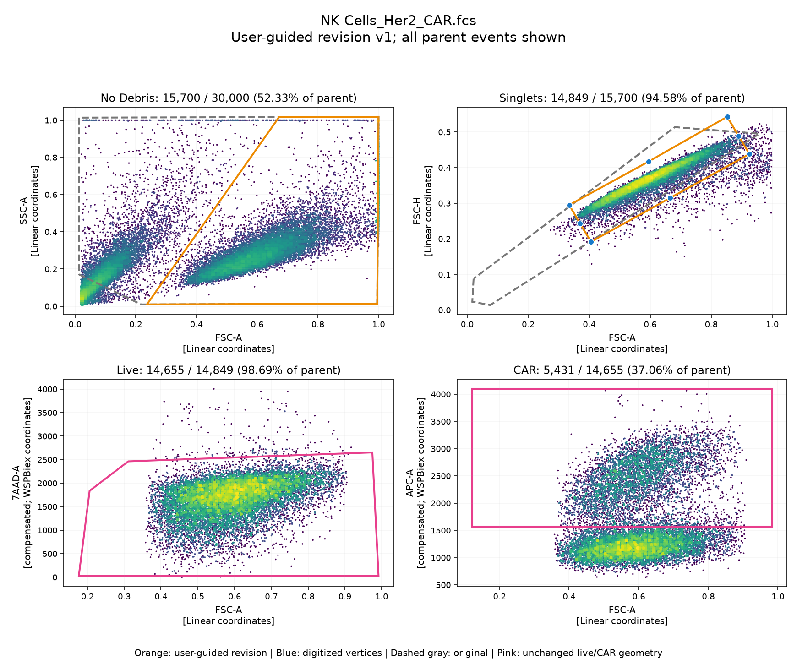

<details>

<summary>Compare the original and revised first two gates</summary>


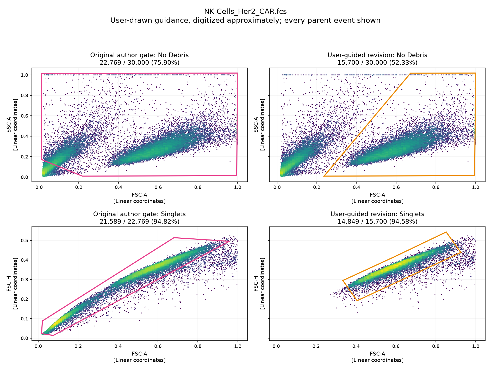

</details>

Checks passed for the first-gate half-plane rule, an independent singlet polygon calculation, unchanged downstream processing, event order, event subsets, parent containment, denominators, and plotted gate geometry.

[Gate comparison CSV](assets/testing/reviews/nk-her2-v1/gate-comparison.csv) · [Results and coordinates](assets/testing/reviews/nk-her2-v1/results.json) · [Digitization configuration](assets/testing/reviews/nk-her2-v1/configuration.json) · [Original user drawing](assets/testing/reviews/nk-her2-v1/user-guidance.png)

## Author gating hierarchies

The CAR-NK author workspaces provide actual scatter → singlet → live → CAR hierarchies. Each four-panel figure shows only the events in that gate’s parent. Axes retain the workspace compensation and transformation settings. Click a sample name for its full-resolution figure.

| Workspace | File / scatterplot | Input events | Live events | CAR / live | CAR (% of live) | CAR events changed without compensation |
|---|---|---:|---:|---:|---:|---:|
| Her2High.wsp | [NK Cells_Her2_CAR.fcs](assets/testing/bbb346f11e2432c8.png) | 30,000 | 14,628 | 5,385 / 14,628 | 36.81% | 254 |
| Her2High.wsp | [NK Cells_RNP_Her2.fcs](assets/testing/2161b12b4a4d0f42.png) | 30,000 | 22,180 | 78 / 22,180 | 0.35% | 32 |
| Figure1Low.wsp | [Her2_CAR.fcs](assets/testing/4ee37b2028e7fa1d.png) | 15,260 | 8,185 | 758 / 8,185 | 9.26% | 0 |
| Figure1Low.wsp | [RNP-NK.fcs](assets/testing/3a32dd9e27581e9d.png) | 10,710 | 3,470 | 17 / 3,470 | 0.49% | 0 |
| Sorting.wsp | [aftersort_APC-.fcs](assets/testing/c288af0aaaae213e.png) | 376 | 310 | 1 / 310 | 0.32% | 0 |
| Sorting.wsp | [aftersort_APC+.fcs](assets/testing/080ac4eac6e6036d.png) | 76 | 38 | 37 / 38 | 97.37% | 0 |
| Sorting.wsp | [beforesort_car-NK.fcs](assets/testing/7c90276577e822f6.png) | 10,000 | 4,709 | 642 / 4,709 | 13.63% | 7 |

The 76-event `aftersort_APC+.fcs` file has only 38 live events. Its 97.37% CAR/live fraction is 37 events out of 38 and should not be interpreted as a precise product-quality estimate.

**High-CAR example and matching RNP file**

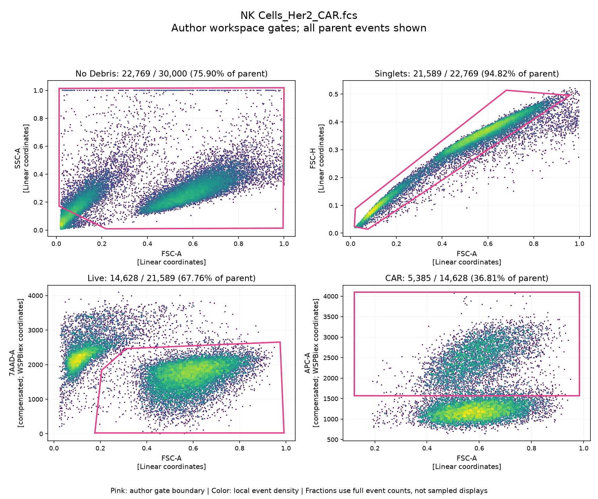

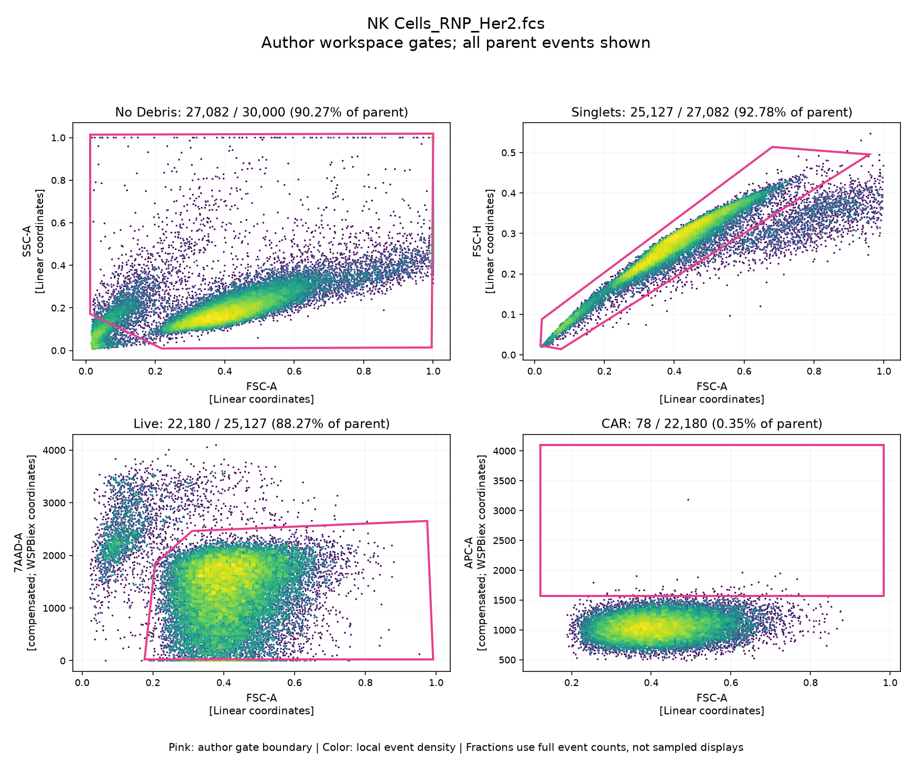

<details>

<summary>Show all seven author hierarchy figures</summary>


**Her2High.wsp · NK Cells_Her2_CAR.fcs**


**Her2High.wsp · NK Cells_RNP_Her2.fcs**


**Figure1Low.wsp · Her2_CAR.fcs**

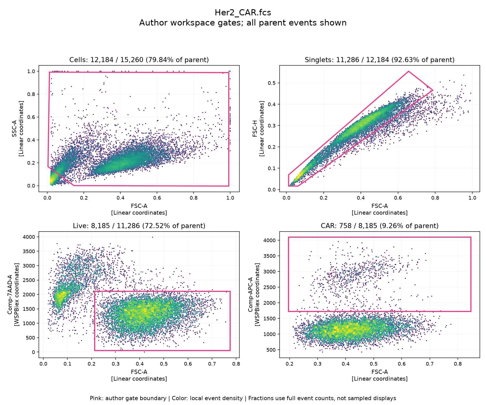

**Figure1Low.wsp · RNP-NK.fcs**

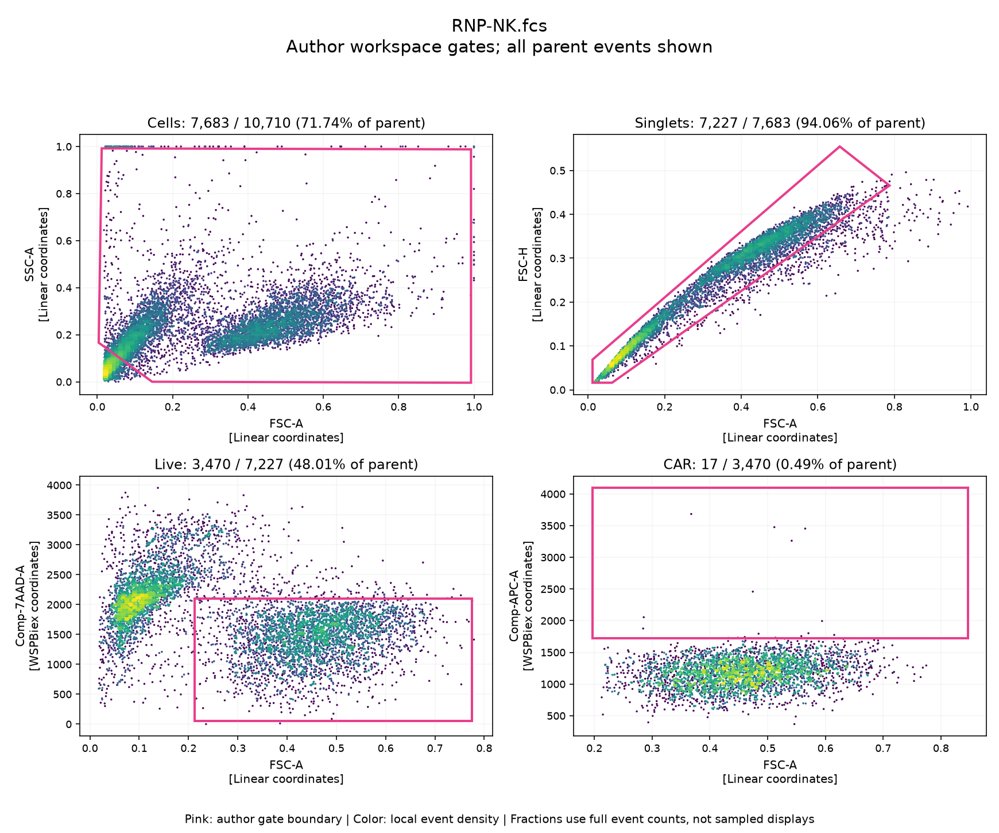

**Sorting.wsp · aftersort_APC-.fcs**

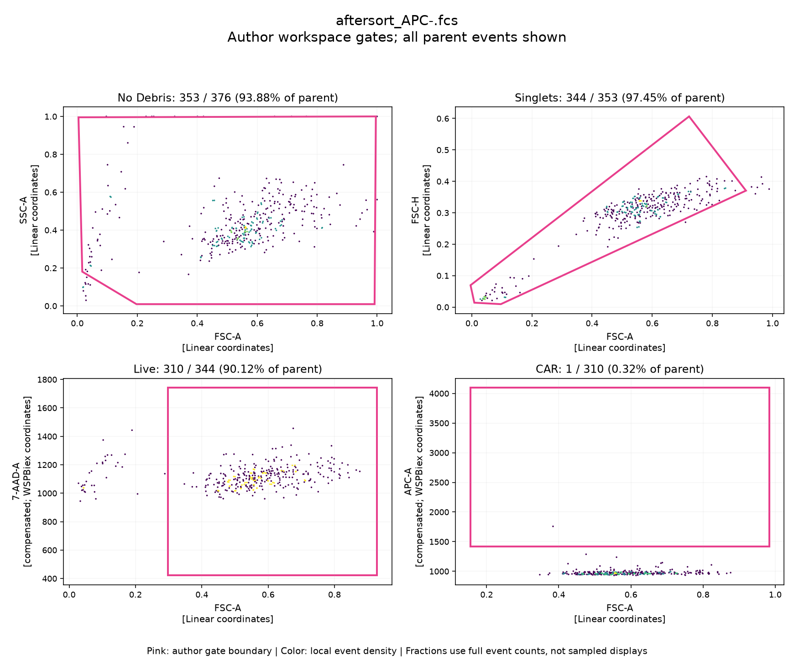

**Sorting.wsp · aftersort_APC+.fcs**

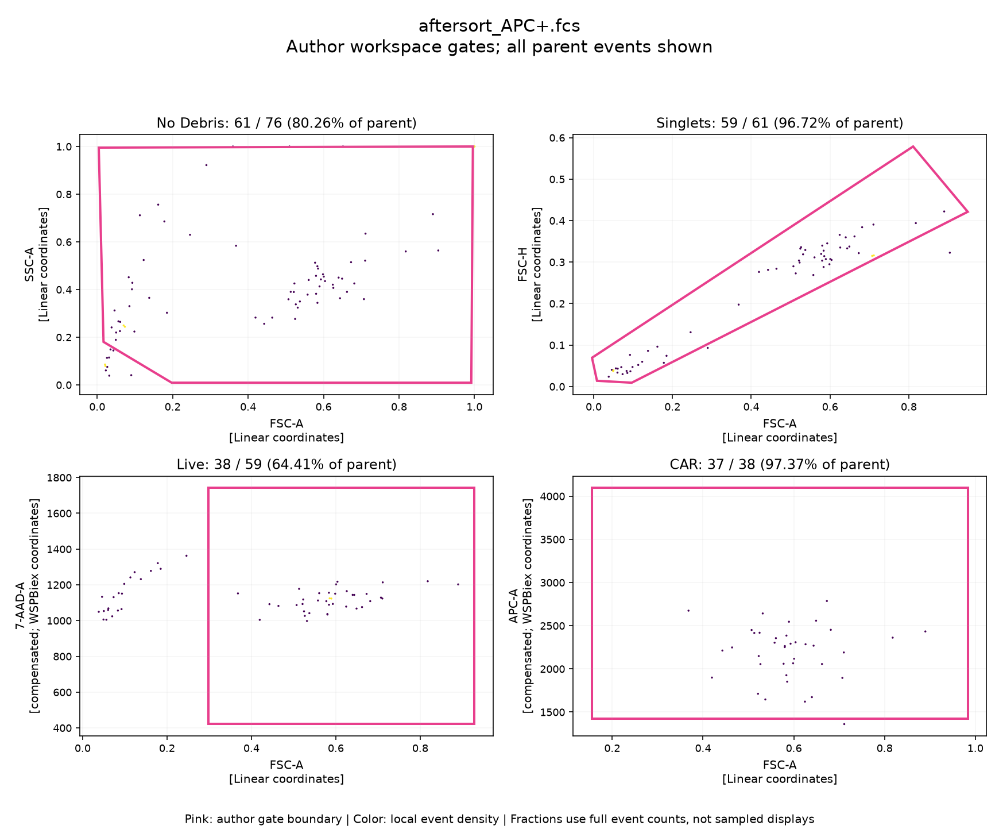

**Sorting.wsp · beforesort_car-NK.fcs**

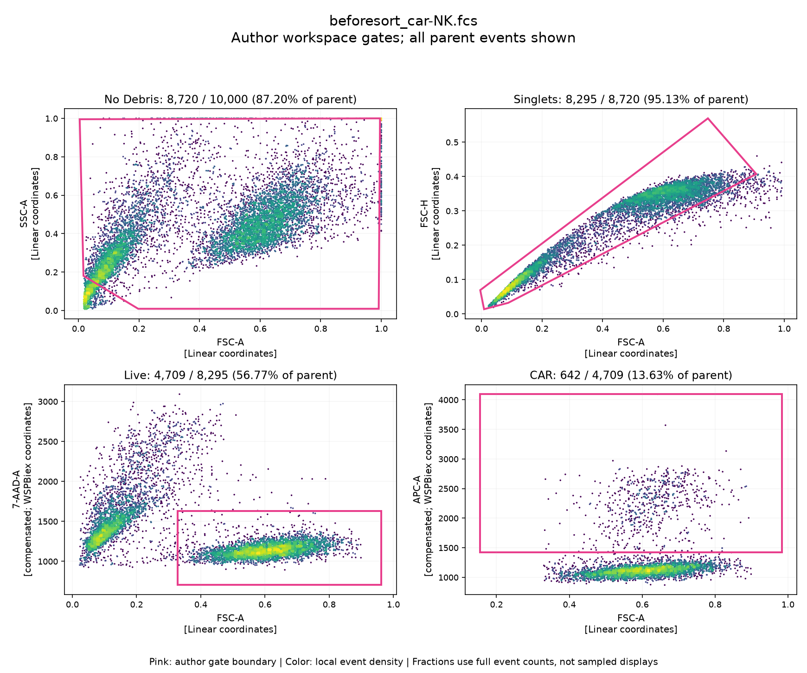

</details>

## HER2 CAR-T engineering gates

All 71 available HER2 files have FSC-A versus SSC-A and FSC-A versus FSC-H scatterplots. The vertical pink line is the separately fitted openCyto FSC-A threshold; the selected region is to its right. The second panel is a scatter view, not an automatically fitted singlet gate. Fluorescence compensation is not used for these scatter-only gates.

Retained fractions range from **0.213% to 76.719%**. This variation requires biological review; zero engine mismatches does not establish that appropriate cells were selected.

The overview below includes 12 files spaced evenly through the sorted retained-fraction range, including both extremes. Every one of the 71 full-resolution figures is linked in the complete file index.

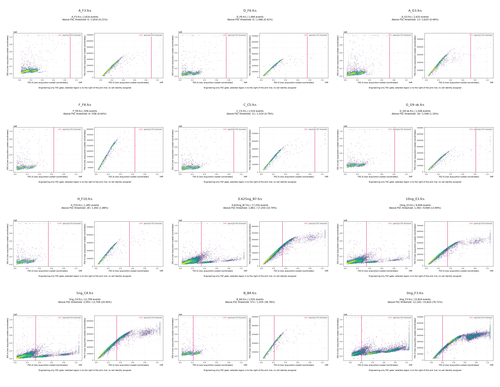

## Other existing data

The adjacent GFP, Treg, and remaining NK files have raw FSC-A/SSC-A and FSC-A/FSC-H plots. No biological gates are invented for these files. Control and derivative roles are preserved in the full index. These are supporting/raw QC views, not additional autogating validations.

### t-cell-gfp-knockin

67 files · 188,153 events. Overview includes up to 12 files; all files are linked below.

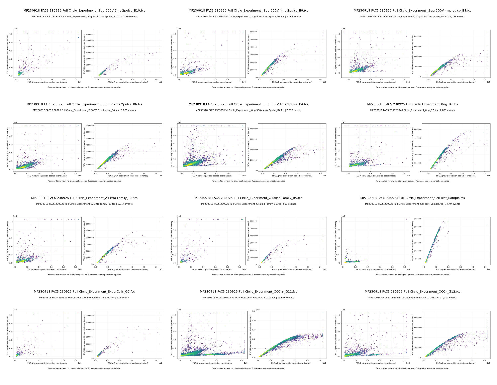

### treg-characterization

8 files · 205,772 events. Overview includes up to 12 files; all files are linked below.

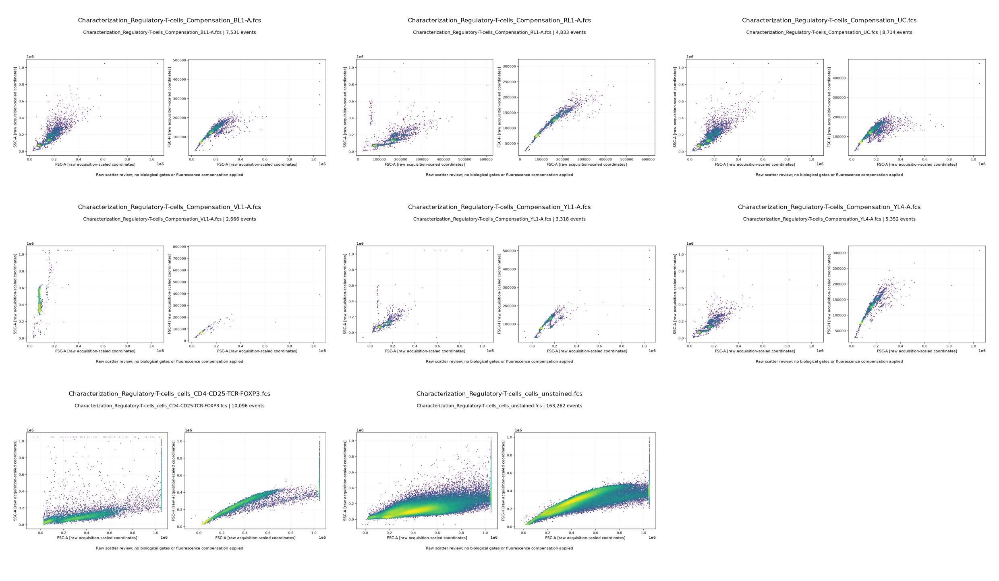

### car-nk-knockin

13 files · 442,676 events. Overview includes up to 12 files; all files are linked below.

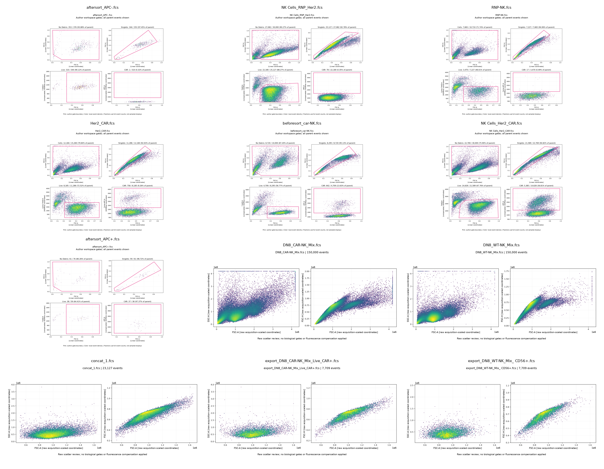

## Complete file index

Each linked image contains actual event scatterplots. Percentages below use the named denominator; empty cells mean no gate was applied. File counts are not donor or biological-sample counts.

<details>

<summary>car-nk-knockin: all 13 scatterplot figures and results</summary>


| File / scatterplot | Source role | Events | Analysis | Selected / denominator | Percent |
|---|---|---:|---|---:|---:|
| [NK Cells_Her2_CAR.fcs](assets/testing/bbb346f11e2432c8.png) | unresolved_acquisition | 30,000 | Author gate replay (live parent) | 5,385 / 14,628 | 36.813% |
| [NK Cells_RNP_Her2.fcs](assets/testing/2161b12b4a4d0f42.png) | unresolved_acquisition | 30,000 | Author gate replay (live parent) | 78 / 22,180 | 0.352% |
| [Her2_CAR.fcs](assets/testing/4ee37b2028e7fa1d.png) | unresolved_acquisition | 15,260 | Author gate replay (live parent) | 758 / 8,185 | 9.261% |
| [RNP-NK.fcs](assets/testing/3a32dd9e27581e9d.png) | unresolved_acquisition | 10,710 | Author gate replay (live parent) | 17 / 3,470 | 0.490% |
| [concat_1.fcs](assets/testing/f2636c06f7149850.png) | concatenation | 23,127 | Raw scatter only | Not applied | Not applied |
| [DN8_CAR-NK_Mix.fcs](assets/testing/d40c4cecc9941f95.png) | unresolved_acquisition | 150,000 | Raw scatter only | Not applied | Not applied |
| [DN8_WT-NK_Mix.fcs](assets/testing/774242d71edac6ec.png) | unresolved_acquisition | 150,000 | Raw scatter only | Not applied | Not applied |
| [export_DN8_CAR-NK_Mix_Live_CAR-.fcs](assets/testing/2558e007a4af858c.png) | exported_subset | 7,709 | Raw scatter only | Not applied | Not applied |
| [export_DN8_CAR-NK_Mix_Live_CAR+.fcs](assets/testing/de409bf20713060d.png) | exported_subset | 7,709 | Raw scatter only | Not applied | Not applied |
| [export_DN8_WT-NK_Mix_ CD56+.fcs](assets/testing/43700b70b9d85993.png) | exported_subset | 7,709 | Raw scatter only | Not applied | Not applied |
| [aftersort_APC-.fcs](assets/testing/c288af0aaaae213e.png) | unresolved_acquisition | 376 | Author gate replay (live parent) | 1 / 310 | 0.323% |
| [aftersort_APC+.fcs](assets/testing/080ac4eac6e6036d.png) | unresolved_acquisition | 76 | Author gate replay (live parent) | 37 / 38 | 97.368% |
| [beforesort_car-NK.fcs](assets/testing/7c90276577e822f6.png) | unresolved_acquisition | 10,000 | Author gate replay (live parent) | 642 / 4,709 | 13.633% |


</details>

<details>

<summary>her2-car-t: all 71 scatterplot figures and results</summary>


| File / scatterplot | Source role | Events | Analysis | Selected / denominator | Percent |
|---|---|---:|---|---:|---:|
| [0.625ng_B7.fcs](assets/testing/801f01ec048c8360.png) | unresolved_acquisition | 17,250 | openCyto FSC engineering gate (all events) | 1,861 / 17,250 | 10.788% |
| [0.625ng_C7.fcs](assets/testing/afc09cd791a4de33.png) | unresolved_acquisition | 21,936 | openCyto FSC engineering gate (all events) | 4,306 / 21,936 | 19.630% |
| [0.625ng_D7.fcs](assets/testing/89fbcd7c2f0e2b34.png) | unresolved_acquisition | 17,399 | openCyto FSC engineering gate (all events) | 3,015 / 17,399 | 17.329% |
| [0.625ng_E7.fcs](assets/testing/5fdb23bcb94f7b32.png) | unresolved_acquisition | 15,987 | openCyto FSC engineering gate (all events) | 2,645 / 15,987 | 16.545% |
| [0.625ng_F7 failure.fcs](assets/testing/ecd13de4221d9350.png) | unresolved_acquisition | 38,093 | openCyto FSC engineering gate (all events) | 20,175 / 38,093 | 52.962% |
| [0.625ng_G7.fcs](assets/testing/21079b4d38d6443e.png) | unresolved_acquisition | 11,436 | openCyto FSC engineering gate (all events) | 1,520 / 11,436 | 13.291% |
| [0.3125ng_B8.fcs](assets/testing/06d2dd8b350ed5b3.png) | unresolved_acquisition | 6,442 | openCyto FSC engineering gate (all events) | 598 / 6,442 | 9.283% |
| [0.3125ng_C8.fcs](assets/testing/7cd8a4f8c41b8a28.png) | unresolved_acquisition | 7,794 | openCyto FSC engineering gate (all events) | 750 / 7,794 | 9.623% |
| [0.3125ng_F8.fcs](assets/testing/5803f7381d92168c.png) | unresolved_acquisition | 9,824 | openCyto FSC engineering gate (all events) | 1,011 / 9,824 | 10.291% |
| [0.3125ng_G8.fcs](assets/testing/95466bb34b177740.png) | unresolved_acquisition | 24,552 | openCyto FSC engineering gate (all events) | 4,247 / 24,552 | 17.298% |
| [0ng_B3.fcs](assets/testing/38b15f605cbef379.png) | unresolved_acquisition | 6,763 | openCyto FSC engineering gate (all events) | 3,799 / 6,763 | 56.173% |
| [0ng_C3.fcs](assets/testing/a0a9ec16f9977363.png) | unresolved_acquisition | 5,621 | openCyto FSC engineering gate (all events) | 3,489 / 5,621 | 62.071% |
| [0ng_D3.fcs](assets/testing/e84f22c8d6484300.png) | unresolved_acquisition | 6,671 | openCyto FSC engineering gate (all events) | 3,307 / 6,671 | 49.573% |
| [0ng_F3.fcs](assets/testing/d2daef157e86c9b8.png) | unresolved_acquisition | 15,824 | openCyto FSC engineering gate (all events) | 12,140 / 15,824 | 76.719% |
| [0ng_G3.fcs](assets/testing/ae276c2aa48b81e8.png) | unresolved_acquisition | 5,390 | openCyto FSC engineering gate (all events) | 3,150 / 5,390 | 58.442% |
| [5ng_B4.fcs](assets/testing/f3e6965fea794fcc.png) | unresolved_acquisition | 9,845 | openCyto FSC engineering gate (all events) | 1,178 / 9,845 | 11.965% |
| [5ng_C4.fcs](assets/testing/3c18cd2f502e6129.png) | unresolved_acquisition | 12,709 | openCyto FSC engineering gate (all events) | 2,593 / 12,709 | 20.403% |
| [5ng_D4.fcs](assets/testing/064c7ba247f1ea60.png) | unresolved_acquisition | 8,518 | openCyto FSC engineering gate (all events) | 1,105 / 8,518 | 12.973% |
| [5ng_E4.fcs](assets/testing/e4f105bcae71d580.png) | unresolved_acquisition | 10,224 | openCyto FSC engineering gate (all events) | 1,513 / 10,224 | 14.799% |
| [5ng_F4.fcs](assets/testing/dec141228dc03ced.png) | unresolved_acquisition | 13,529 | openCyto FSC engineering gate (all events) | 1,764 / 13,529 | 13.039% |
| [10ng_C3.fcs](assets/testing/dd527d6097d22c6f.png) | unresolved_acquisition | 10,877 | openCyto FSC engineering gate (all events) | 1,142 / 10,877 | 10.499% |
| [10ng_D3.fcs](assets/testing/8dec756df1ff9157.png) | unresolved_acquisition | 7,276 | openCyto FSC engineering gate (all events) | 675 / 7,276 | 9.277% |
| [10ng_E3.fcs](assets/testing/7aee60998c2e5d1b.png) | unresolved_acquisition | 9,949 | openCyto FSC engineering gate (all events) | 1,392 / 9,949 | 13.991% |
| [10ng_F3.fcs](assets/testing/c5225b97b857ee2d.png) | unresolved_acquisition | 15,340 | openCyto FSC engineering gate (all events) | 2,474 / 15,340 | 16.128% |
| [10ng_G3.fcs](assets/testing/604d88ffc86073f5.png) | unresolved_acquisition | 18,317 | openCyto FSC engineering gate (all events) | 2,225 / 18,317 | 12.147% |
| [F_B8.fcs](assets/testing/ad7690909cf6bf49.png) | unresolved_acquisition | 1,004 | openCyto FSC engineering gate (all events) | 6 / 1,004 | 0.598% |
| [F_C8.fcs](assets/testing/59a33e93ba846e59.png) | unresolved_acquisition | 964 | openCyto FSC engineering gate (all events) | 4 / 964 | 0.415% |
| [F_E8.fcs](assets/testing/d2ce90371cf12ff8.png) | unresolved_acquisition | 1,017 | openCyto FSC engineering gate (all events) | 4 / 1,017 | 0.393% |
| [F_F8.fcs](assets/testing/639c6625e05e656f.png) | unresolved_acquisition | 936 | openCyto FSC engineering gate (all events) | 6 / 936 | 0.641% |
| [F_G8.fcs](assets/testing/e58bc1334d4504b9.png) | unresolved_acquisition | 1,067 | openCyto FSC engineering gate (all events) | 3 / 1,067 | 0.281% |
| [G_B9.fcs](assets/testing/3737c971e7591299.png) | unresolved_acquisition | 941 | openCyto FSC engineering gate (all events) | 6 / 941 | 0.638% |
| [G_C9.fcs](assets/testing/928362c98f235c32.png) | unresolved_acquisition | 1,150 | openCyto FSC engineering gate (all events) | 7 / 1,150 | 0.609% |
| [G_D9.fcs](assets/testing/b56468f25b74bd62.png) | unresolved_acquisition | 1,006 | openCyto FSC engineering gate (all events) | 11 / 1,006 | 1.093% |
| [G_E9.fcs](assets/testing/b164059328bf7394.png) | unresolved_acquisition | 1,264 | openCyto FSC engineering gate (all events) | 341 / 1,264 | 26.978% |
| [G_F9 ok.fcs](assets/testing/acd1e137854515b0.png) | unresolved_acquisition | 1,475 | openCyto FSC engineering gate (all events) | 27 / 1,475 | 1.831% |
| [G_G9 ok.fcs](assets/testing/356dd533ba6e976d.png) | unresolved_acquisition | 1,548 | openCyto FSC engineering gate (all events) | 18 / 1,548 | 1.163% |
| [H_B10.fcs](assets/testing/5901c8aa248b097a.png) | unresolved_acquisition | 1,287 | openCyto FSC engineering gate (all events) | 15 / 1,287 | 1.166% |
| [H_C10.fcs](assets/testing/88ffb3d0d9c32f97.png) | unresolved_acquisition | 1,101 | openCyto FSC engineering gate (all events) | 7 / 1,101 | 0.636% |
| [H_D10 ok.fcs](assets/testing/bf02f44c15cb2e2e.png) | unresolved_acquisition | 1,461 | openCyto FSC engineering gate (all events) | 6 / 1,461 | 0.411% |
| [H_E10.fcs](assets/testing/bcccc6ae354b13b9.png) | unresolved_acquisition | 1,411 | openCyto FSC engineering gate (all events) | 13 / 1,411 | 0.921% |
| [H_F10.fcs](assets/testing/d8cfed1ccb1ddf21.png) | unresolved_acquisition | 1,492 | openCyto FSC engineering gate (all events) | 28 / 1,492 | 1.877% |
| [A_B3.fcs](assets/testing/13f5798e71ad3e25.png) | unresolved_acquisition | 3,427 | openCyto FSC engineering gate (all events) | 1,290 / 3,427 | 37.642% |
| [A_C3.fcs](assets/testing/7bf72b87c4bb41d8.png) | unresolved_acquisition | 1,943 | openCyto FSC engineering gate (all events) | 13 / 1,943 | 0.669% |
| [A_D3.fcs](assets/testing/d19df734d749819b.png) | unresolved_acquisition | 1,466 | openCyto FSC engineering gate (all events) | 4 / 1,466 | 0.273% |
| [A_E3.fcs](assets/testing/6f5a596e3d92aac0.png) | unresolved_acquisition | 2,181 | openCyto FSC engineering gate (all events) | 7 / 2,181 | 0.321% |
| [A_F3.fcs](assets/testing/d54863df0933ecbe.png) | unresolved_acquisition | 2,816 | openCyto FSC engineering gate (all events) | 6 / 2,816 | 0.213% |
| [A_G3.fcs](assets/testing/1c07e338c82344bb.png) | unresolved_acquisition | 2,633 | openCyto FSC engineering gate (all events) | 13 / 2,633 | 0.494% |
| [B_B4.fcs](assets/testing/2625a81556c9f2fc.png) | unresolved_acquisition | 1,555 | openCyto FSC engineering gate (all events) | 572 / 1,555 | 36.785% |
| [B_C4.fcs](assets/testing/60c89794c1f160c6.png) | unresolved_acquisition | 1,289 | openCyto FSC engineering gate (all events) | 10 / 1,289 | 0.776% |
| [B_D4 good.fcs](assets/testing/d6e8e5a71f029f4b.png) | unresolved_acquisition | 2,356 | openCyto FSC engineering gate (all events) | 14 / 2,356 | 0.594% |
| [B_E4.fcs](assets/testing/aae941f53929958e.png) | unresolved_acquisition | 1,194 | openCyto FSC engineering gate (all events) | 11 / 1,194 | 0.921% |
| [B_F4.fcs](assets/testing/2c3aa3b8f48ab5e0.png) | unresolved_acquisition | 1,683 | openCyto FSC engineering gate (all events) | 516 / 1,683 | 30.660% |
| [B_G4.fcs](assets/testing/9db4a7bd2176af05.png) | unresolved_acquisition | 1,541 | openCyto FSC engineering gate (all events) | 28 / 1,541 | 1.817% |
| [C_B5 ok.fcs](assets/testing/0f19f62ae2569862.png) | unresolved_acquisition | 1,937 | openCyto FSC engineering gate (all events) | 15 / 1,937 | 0.774% |
| [C_C5.fcs](assets/testing/ccdbf81e2a7be6ac.png) | unresolved_acquisition | 1,524 | openCyto FSC engineering gate (all events) | 12 / 1,524 | 0.787% |
| [C_D5.fcs](assets/testing/322a8201e2e7344a.png) | unresolved_acquisition | 1,124 | openCyto FSC engineering gate (all events) | 11 / 1,124 | 0.979% |
| [C_E5.fcs](assets/testing/e27c581831cd584d.png) | unresolved_acquisition | 1,545 | openCyto FSC engineering gate (all events) | 21 / 1,545 | 1.359% |
| [C_F5.fcs](assets/testing/fffb85ce8cbccb37.png) | unresolved_acquisition | 2,055 | openCyto FSC engineering gate (all events) | 10 / 2,055 | 0.487% |
| [C_G5 ok.fcs](assets/testing/24503da033e1539e.png) | unresolved_acquisition | 2,222 | openCyto FSC engineering gate (all events) | 744 / 2,222 | 33.483% |
| [D_B6.fcs](assets/testing/fa4674c48f2bebed.png) | unresolved_acquisition | 1,699 | openCyto FSC engineering gate (all events) | 603 / 1,699 | 35.491% |
| [D_C6.fcs](assets/testing/8479c9b69986a132.png) | unresolved_acquisition | 1,431 | openCyto FSC engineering gate (all events) | 17 / 1,431 | 1.188% |
| [D_D6.fcs](assets/testing/c781c5f235b4c5d0.png) | unresolved_acquisition | 1,127 | openCyto FSC engineering gate (all events) | 14 / 1,127 | 1.242% |
| [D_E6 ok.fcs](assets/testing/f61e3ab7c22ec8e6.png) | unresolved_acquisition | 1,435 | openCyto FSC engineering gate (all events) | 7 / 1,435 | 0.488% |
| [D_F6.fcs](assets/testing/26dcaa9c98222896.png) | unresolved_acquisition | 1,466 | openCyto FSC engineering gate (all events) | 6 / 1,466 | 0.409% |
| [D_G6.fcs](assets/testing/c87e98fa57c0114a.png) | unresolved_acquisition | 1,156 | openCyto FSC engineering gate (all events) | 8 / 1,156 | 0.692% |
| [E control_B7.fcs](assets/testing/5cecdfa6774d90c6.png) | unresolved_acquisition | 1,234 | openCyto FSC engineering gate (all events) | 8 / 1,234 | 0.648% |
| [E control_C7.fcs](assets/testing/cb5a96aebc9a5d4e.png) | unresolved_acquisition | 1,294 | openCyto FSC engineering gate (all events) | 11 / 1,294 | 0.850% |
| [E control_D7.fcs](assets/testing/68dd44c79a6ae70b.png) | unresolved_acquisition | 975 | openCyto FSC engineering gate (all events) | 5 / 975 | 0.513% |
| [E control_E7.fcs](assets/testing/8e0a2f9aceb9c350.png) | unresolved_acquisition | 1,573 | openCyto FSC engineering gate (all events) | 7 / 1,573 | 0.445% |
| [E control_F7.fcs](assets/testing/668603f84a701535.png) | unresolved_acquisition | 1,649 | openCyto FSC engineering gate (all events) | 4 / 1,649 | 0.243% |
| [E control_G7.fcs](assets/testing/aa4426ffc9d65562.png) | unresolved_acquisition | 1,677 | openCyto FSC engineering gate (all events) | 557 / 1,677 | 33.214% |


</details>

<details>

<summary>t-cell-gfp-knockin: all 67 scatterplot figures and results</summary>


| File / scatterplot | Source role | Events | Analysis | Selected / denominator | Percent |
|---|---|---:|---|---:|---:|
| [MP230918 FACS 230925 Full Circle_Experiment_Extra Cells_G2.fcs](assets/testing/fc6d3d2ab9573992.png) | unresolved_acquisition | 523 | Raw scatter only | Not applied | Not applied |
| [MP230918 FACS 230925 Full Circle_Experiment_Extra Cells_B2.fcs](assets/testing/629d10e329b30bde.png) | unresolved_acquisition | 543 | Raw scatter only | Not applied | Not applied |
| [MP230918 FACS 230925 Full Circle_Experiment_Extra Cells_C2.fcs](assets/testing/aad23b0f598d9be5.png) | unresolved_acquisition | 274 | Raw scatter only | Not applied | Not applied |
| [MP230918 FACS 230925 Full Circle_Experiment_Extra Cells_D2.fcs](assets/testing/8a2950af45bda3e7.png) | unresolved_acquisition | 296 | Raw scatter only | Not applied | Not applied |
| [MP230918 FACS 230925 Full Circle_Experiment_Extra Cells_E2.fcs](assets/testing/1251b883062f9ce1.png) | unresolved_acquisition | 396 | Raw scatter only | Not applied | Not applied |
| [MP230918 FACS 230925 Full Circle_Experiment_Extra Cells_F2.fcs](assets/testing/3c3c4512fc315685.png) | unresolved_acquisition | 341 | Raw scatter only | Not applied | Not applied |
| [MP230918 FACS 230925 Full Circle_Experiment_C Failed Family_B5.fcs](assets/testing/dff2105c13fa5849.png) | unresolved_acquisition | 601 | Raw scatter only | Not applied | Not applied |
| [MP230918 FACS 230925 Full Circle_Experiment_C Failed Family_C5.fcs](assets/testing/82c69912ea454f4a.png) | unresolved_acquisition | 452 | Raw scatter only | Not applied | Not applied |
| [MP230918 FACS 230925 Full Circle_Experiment_C Failed Family_D5.fcs](assets/testing/ad8dc63a78b1ed87.png) | unresolved_acquisition | 3,199 | Raw scatter only | Not applied | Not applied |
| [MP230918 FACS 230925 Full Circle_Experiment_C Failed Family_E5.fcs](assets/testing/dc52cd09b85bec9b.png) | unresolved_acquisition | 106 | Raw scatter only | Not applied | Not applied |
| [MP230918 FACS 230925 Full Circle_Experiment_C Failed Family_F5.fcs](assets/testing/cfd48f1c61e4e242.png) | unresolved_acquisition | 2,963 | Raw scatter only | Not applied | Not applied |
| [MP230918 FACS 230925 Full Circle_Experiment_C Failed Family_G5.fcs](assets/testing/bbbb9b0d12f59ea6.png) | unresolved_acquisition | 579 | Raw scatter only | Not applied | Not applied |
| [MP230918 FACS 230925 Full Circle_Experiment_Cell Test_Sample.fcs](assets/testing/26eb0bf4486922f7.png) | unresolved_acquisition | 1,549 | Raw scatter only | Not applied | Not applied |
| [MP230918 FACS 230925 Full Circle_Experiment_A Extra Family_B3.fcs](assets/testing/92a8710db4e49656.png) | unresolved_acquisition | 2,014 | Raw scatter only | Not applied | Not applied |
| [MP230918 FACS 230925 Full Circle_Experiment_A Extra Family_C3.fcs](assets/testing/14d4a548e75991fa.png) | unresolved_acquisition | 2,365 | Raw scatter only | Not applied | Not applied |
| [MP230918 FACS 230925 Full Circle_Experiment_A Extra Family_D3.fcs](assets/testing/4fafa96056f79134.png) | unresolved_acquisition | 1,466 | Raw scatter only | Not applied | Not applied |
| [MP230918 FACS 230925 Full Circle_Experiment_A Extra Family_E3.fcs](assets/testing/ea348a76bf33f951.png) | unresolved_acquisition | 1,599 | Raw scatter only | Not applied | Not applied |
| [MP230918 FACS 230925 Full Circle_Experiment_A Extra Family_F3.fcs](assets/testing/ad6945c877f204ed.png) | unresolved_acquisition | 1,850 | Raw scatter only | Not applied | Not applied |
| [MP230918 FACS 230925 Full Circle_Experiment_A Extra Family_G3.fcs](assets/testing/8d7054d12c48222c.png) | unresolved_acquisition | 1,237 | Raw scatter only | Not applied | Not applied |
| [MP230918 FACS 230925 Full Circle_Experiment_OCC -_B12.fcs](assets/testing/2f3fdb0723450214.png) | unresolved_acquisition | 5,167 | Raw scatter only | Not applied | Not applied |
| [MP230918 FACS 230925 Full Circle_Experiment_OCC -_C12.fcs](assets/testing/88050b02381afe77.png) | unresolved_acquisition | 2,615 | Raw scatter only | Not applied | Not applied |
| [MP230918 FACS 230925 Full Circle_Experiment_OCC -_D12.fcs](assets/testing/46c0ba91367eb2b4.png) | unresolved_acquisition | 3,599 | Raw scatter only | Not applied | Not applied |
| [MP230918 FACS 230925 Full Circle_Experiment_OCC -_E12.fcs](assets/testing/fb520bb8fec593f5.png) | unresolved_acquisition | 3,513 | Raw scatter only | Not applied | Not applied |
| [MP230918 FACS 230925 Full Circle_Experiment_OCC -_F12.fcs](assets/testing/8639eef946247df9.png) | unresolved_acquisition | 3,541 | Raw scatter only | Not applied | Not applied |
| [MP230918 FACS 230925 Full Circle_Experiment_OCC -_G12.fcs](assets/testing/c6b5ef4a0aa760b1.png) | unresolved_acquisition | 4,110 | Raw scatter only | Not applied | Not applied |
| [MP230918 FACS 230925 Full Circle_Experiment_OCC +_G11.fcs](assets/testing/7fe3b0cf00d0239f.png) | unresolved_acquisition | 13,656 | Raw scatter only | Not applied | Not applied |
| [MP230918 FACS 230925 Full Circle_Experiment_OCC +_B11.fcs](assets/testing/3a975b8f35bbe4c2.png) | unresolved_acquisition | 2,299 | Raw scatter only | Not applied | Not applied |
| [MP230918 FACS 230925 Full Circle_Experiment_OCC +_C11.fcs](assets/testing/4e6170bc0e375d08.png) | unresolved_acquisition | 2,131 | Raw scatter only | Not applied | Not applied |
| [MP230918 FACS 230925 Full Circle_Experiment_OCC +_D11.fcs](assets/testing/cb9188523f40937a.png) | unresolved_acquisition | 2,101 | Raw scatter only | Not applied | Not applied |
| [MP230918 FACS 230925 Full Circle_Experiment_OCC +_E11.fcs](assets/testing/b7fa5f697f3c0f8f.png) | unresolved_acquisition | 2,276 | Raw scatter only | Not applied | Not applied |
| [MP230918 FACS 230925 Full Circle_Experiment_OCC +_F11.fcs](assets/testing/c96658023c752ee6.png) | unresolved_acquisition | 5,943 | Raw scatter only | Not applied | Not applied |
| [MP230918 FACS 230925 Full Circle_Experiment_.6ug 500V 4ms 2pulse_B4.fcs](assets/testing/11faa7314b8c17ca.png) | unresolved_acquisition | 7,073 | Raw scatter only | Not applied | Not applied |
| [MP230918 FACS 230925 Full Circle_Experiment_.6ug 500V 4ms 2pulse_C4.fcs](assets/testing/c672fa8e97f8bad6.png) | unresolved_acquisition | 5,212 | Raw scatter only | Not applied | Not applied |
| [MP230918 FACS 230925 Full Circle_Experiment_.6ug 500V 4ms 2pulse_D4.fcs](assets/testing/3ab2637171037a8c.png) | unresolved_acquisition | 4,934 | Raw scatter only | Not applied | Not applied |
| [MP230918 FACS 230925 Full Circle_Experiment_.6ug 500V 4ms 2pulse_E4.fcs](assets/testing/56bf1e73add538e0.png) | unresolved_acquisition | 4,347 | Raw scatter only | Not applied | Not applied |
| [MP230918 FACS 230925 Full Circle_Experiment_.6ug 500V 4ms 2pulse_F4.fcs](assets/testing/a1764278739fb0aa.png) | unresolved_acquisition | 7,835 | Raw scatter only | Not applied | Not applied |
| [MP230918 FACS 230925 Full Circle_Experiment_.6ug 500V 4ms 2pulse_G4.fcs](assets/testing/5339ccb2f6fdb640.png) | unresolved_acquisition | 6,342 | Raw scatter only | Not applied | Not applied |
| [MP230918 FACS 230925 Full Circle_Experiment_0ug_B7.fcs](assets/testing/594e94fac97f007a.png) | unresolved_acquisition | 2,891 | Raw scatter only | Not applied | Not applied |
| [MP230918 FACS 230925 Full Circle_Experiment_0ug_C7.fcs](assets/testing/adacb8a149a5684f.png) | unresolved_acquisition | 2,717 | Raw scatter only | Not applied | Not applied |
| [MP230918 FACS 230925 Full Circle_Experiment_0ug_D7.fcs](assets/testing/d0ab5bd0839a2e7b.png) | unresolved_acquisition | 2,287 | Raw scatter only | Not applied | Not applied |
| [MP230918 FACS 230925 Full Circle_Experiment_0ug_E7.fcs](assets/testing/7fe0404f80cec372.png) | unresolved_acquisition | 2,622 | Raw scatter only | Not applied | Not applied |
| [MP230918 FACS 230925 Full Circle_Experiment_0ug_F7.fcs](assets/testing/ee0b01f6693719f1.png) | unresolved_acquisition | 3,386 | Raw scatter only | Not applied | Not applied |
| [MP230918 FACS 230925 Full Circle_Experiment_0ug_G7.fcs](assets/testing/00db94b7b99ecf13.png) | unresolved_acquisition | 5,953 | Raw scatter only | Not applied | Not applied |
| [MP230918 FACS 230925 Full Circle_Experiment_.6 500V 2ms 2pulse_B6.fcs](assets/testing/8a6ba0de7a8d65f9.png) | unresolved_acquisition | 3,829 | Raw scatter only | Not applied | Not applied |
| [MP230918 FACS 230925 Full Circle_Experiment_.6 500V 2ms 2pulse_C6.fcs](assets/testing/8600376595bcf01e.png) | unresolved_acquisition | 3,165 | Raw scatter only | Not applied | Not applied |
| [MP230918 FACS 230925 Full Circle_Experiment_.6 500V 2ms 2pulse_D6.fcs](assets/testing/d9272e598181f62d.png) | unresolved_acquisition | 2,821 | Raw scatter only | Not applied | Not applied |
| [MP230918 FACS 230925 Full Circle_Experiment_.6 500V 2ms 2pulse_E6.fcs](assets/testing/215499083bb91595.png) | unresolved_acquisition | 2,503 | Raw scatter only | Not applied | Not applied |
| [MP230918 FACS 230925 Full Circle_Experiment_.6 500V 2ms 2pulse_F6.fcs](assets/testing/631ddf84db52245d.png) | unresolved_acquisition | 3,497 | Raw scatter only | Not applied | Not applied |
| [MP230918 FACS 230925 Full Circle_Experiment_.6 500V 2ms 2pulse_G6.fcs](assets/testing/d66527a09f3f76c9.png) | unresolved_acquisition | 2,785 | Raw scatter only | Not applied | Not applied |
| [MP230918 FACS 230925 Full Circle_Experiment_.3ug 500V 4ms 2pulse_D9.fcs](assets/testing/1afdcc9f0f68bb47.png) | unresolved_acquisition | 2,209 | Raw scatter only | Not applied | Not applied |
| [MP230918 FACS 230925 Full Circle_Experiment_.3ug 500V 4ms 2pulse_E9.fcs](assets/testing/94fb1468fe67c259.png) | unresolved_acquisition | 2,297 | Raw scatter only | Not applied | Not applied |
| [MP230918 FACS 230925 Full Circle_Experiment_.3ug 500V 4ms 2pulse_F9.fcs](assets/testing/a6493ca02848a265.png) | unresolved_acquisition | 3,065 | Raw scatter only | Not applied | Not applied |
| [MP230918 FACS 230925 Full Circle_Experiment_.3ug 500V 4ms 2pulse_G9.fcs](assets/testing/04d53d43f9280a72.png) | unresolved_acquisition | 3,271 | Raw scatter only | Not applied | Not applied |
| [MP230918 FACS 230925 Full Circle_Experiment_.3ug 500V 4ms pulse_B8.fcs](assets/testing/ecb92ad16fc004d4.png) | unresolved_acquisition | 3,289 | Raw scatter only | Not applied | Not applied |
| [MP230918 FACS 230925 Full Circle_Experiment_.3ug 500V 4ms pulse_C8.fcs](assets/testing/c51aaddd4975bae4.png) | unresolved_acquisition | 3,245 | Raw scatter only | Not applied | Not applied |
| [MP230918 FACS 230925 Full Circle_Experiment_.3ug 500V 4ms pulse_D8.fcs](assets/testing/5bb8b6c2505ae1e2.png) | unresolved_acquisition | 2,875 | Raw scatter only | Not applied | Not applied |
| [MP230918 FACS 230925 Full Circle_Experiment_.3ug 500V 4ms pulse_E8.fcs](assets/testing/cc8495121c0b16c5.png) | unresolved_acquisition | 3,166 | Raw scatter only | Not applied | Not applied |
| [MP230918 FACS 230925 Full Circle_Experiment_.3ug 500V 4ms pulse_F8.fcs](assets/testing/2b914e565f887460.png) | unresolved_acquisition | 3,212 | Raw scatter only | Not applied | Not applied |
| [MP230918 FACS 230925 Full Circle_Experiment_.3ug 500V 4ms pulse_G8.fcs](assets/testing/0409fc71c3479d6e.png) | unresolved_acquisition | 5,041 | Raw scatter only | Not applied | Not applied |
| [MP230918 FACS 230925 Full Circle_Experiment_.3ug 500V 2ms 2pulse_B10.fcs](assets/testing/bd8001833e4321a7.png) | unresolved_acquisition | 779 | Raw scatter only | Not applied | Not applied |
| [MP230918 FACS 230925 Full Circle_Experiment_.3ug 500V 2ms 2pulse_C10.fcs](assets/testing/bb0a62cae4c0ef6d.png) | unresolved_acquisition | 622 | Raw scatter only | Not applied | Not applied |
| [MP230918 FACS 230925 Full Circle_Experiment_.3ug 500V 2ms 2pulse_D10.fcs](assets/testing/a7a83486d8fe2327.png) | unresolved_acquisition | 668 | Raw scatter only | Not applied | Not applied |
| [MP230918 FACS 230925 Full Circle_Experiment_.3ug 500V 2ms 2pulse_E10.fcs](assets/testing/2e4c5f1846571bf7.png) | unresolved_acquisition | 615 | Raw scatter only | Not applied | Not applied |
| [MP230918 FACS 230925 Full Circle_Experiment_.3ug 500V 2ms 2pulse_F10.fcs](assets/testing/c79f7f3e60e09984.png) | unresolved_acquisition | 639 | Raw scatter only | Not applied | Not applied |
| [MP230918 FACS 230925 Full Circle_Experiment_.3ug 500V 2ms 2pulse_G10.fcs](assets/testing/bd4754a5b4478346.png) | unresolved_acquisition | 802 | Raw scatter only | Not applied | Not applied |
| [MP230918 FACS 230925 Full Circle_Experiment_.3ug 500V 4ms 2pulse_B9.fcs](assets/testing/f9be997d6bebbf12.png) | unresolved_acquisition | 2,063 | Raw scatter only | Not applied | Not applied |
| [MP230918 FACS 230925 Full Circle_Experiment_.3ug 500V 4ms 2pulse_C9.fcs](assets/testing/c0fbc57091666bf9.png) | unresolved_acquisition | 2,792 | Raw scatter only | Not applied | Not applied |


</details>

<details>

<summary>treg-characterization: all 8 scatterplot figures and results</summary>


| File / scatterplot | Source role | Events | Analysis | Selected / denominator | Percent |
|---|---|---:|---|---:|---:|
| [Characterization_Regulatory-T-cells_cells_CD4-CD25-TCR-FOXP3.fcs](assets/testing/f54a1facad710149.png) | unresolved_acquisition | 10,096 | Raw scatter only | Not applied | Not applied |
| [Characterization_Regulatory-T-cells_cells_unstained.fcs](assets/testing/6764021a44eaf149.png) | unstained_control | 163,262 | Raw scatter only | Not applied | Not applied |
| [Characterization_Regulatory-T-cells_Compensation_BL1-A.fcs](assets/testing/8591e75bbe81fc62.png) | compensation_control | 7,531 | Raw scatter only | Not applied | Not applied |
| [Characterization_Regulatory-T-cells_Compensation_RL1-A.fcs](assets/testing/19b11ad1f776bca7.png) | compensation_control | 4,833 | Raw scatter only | Not applied | Not applied |
| [Characterization_Regulatory-T-cells_Compensation_UC.fcs](assets/testing/fb0c475c12685143.png) | compensation_control | 8,714 | Raw scatter only | Not applied | Not applied |
| [Characterization_Regulatory-T-cells_Compensation_VL1-A.fcs](assets/testing/11045b886f6bed57.png) | compensation_control | 2,666 | Raw scatter only | Not applied | Not applied |
| [Characterization_Regulatory-T-cells_Compensation_YL1-A.fcs](assets/testing/d532ae908e510d2c.png) | compensation_control | 3,318 | Raw scatter only | Not applied | Not applied |
| [Characterization_Regulatory-T-cells_Compensation_YL4-A.fcs](assets/testing/8689974b9ebd1bec.png) | compensation_control | 5,352 | Raw scatter only | Not applied | Not applied |


</details>

## Methods and limits

- **Display:** every event is plotted, with local density encoded by a logarithmic color scale (dark purple: sparse; yellow: dense). No event subsampling or quantile clipping is used. Author panels restrict displayed events to their actual parent gates.

- **Geometry:** the author figures use the same preprocessing routine as pinned FlowKit’s own plotting implementation. The figure builder reapplies each gate to those coordinates and verifies exact full-event membership. Each drawn HER2 threshold is independently checked against its saved R membership.

- **Processing:** author axes explicitly state linear/biexponential coordinates and compensation references. No second compensation is applied. Raw scatter panels use acquisition-scaled FCS values without fluorescence compensation or display transforms.

- **Donors:** the HER2 and GFP studies share one reported source donor; Treg represents another reported donor group. NK donor identities remain unresolved. Repeated files and control/exported/concatenated data do not increase donor counts.

- **Excluded representations:** the processed 28-patient fluorescence objects do not retain original acquisition gates. The five CyTOF pilot files are a separate modality. Neither is included in this fluorescence FCS plot set.

- **Missing inputs:** five HER2 FCS files, one cataloged NK FCS file, and `tSNE.wsp` remain unavailable. `Sorting.wsp` additionally references `3days_aftersort_APC+.fcs`, which has no exact matching source filename in the manifest. The different `2days_aftersort_APC+.fcs` filename is never substituted.

- **Portability:** the seven author GatingML exports fail schema validation, including unsupported FlowJo biexponential serialization, invalid XML identifiers, empty fluorochrome labels, and missing compensation references. Workspaces are replayed directly; transformations are not approximated to force export.

- **Validation boundary:** author labels are reference candidates, not independent truth. No CAR release criterion, potency conclusion, rare-population sensitivity, or biological accuracy is inferred.

## Reproduce and inspect evidence

Run from the repository root with the existing data and recorded R image available. No command below downloads data.

```sh
uv sync --locked
uv run pytest -q
uv run scripts/validate_existing_data.py
uv run scripts/validate_opencyto_batch.py
uv run scripts/apply_review_guidance.py
uv run scripts/build_scatter_report.py
```

Raw FCS files, per-event memberships, logs, and invalid diagnostic XML stay under ignored `data/raw/` and `reports/local/`. Curated figures, aggregate result tables, and plot provenance are included here so this GitHub page is usable without local files. The offline gallery is `docs/assets/testing/index.html`; open it locally to search all 159 figures.

The next biological test requires reconciled HER2 markers, controls, and compensation state plus expert-reviewed reference memberships. Collection remains paused, and FlowSOM remains deferred.
